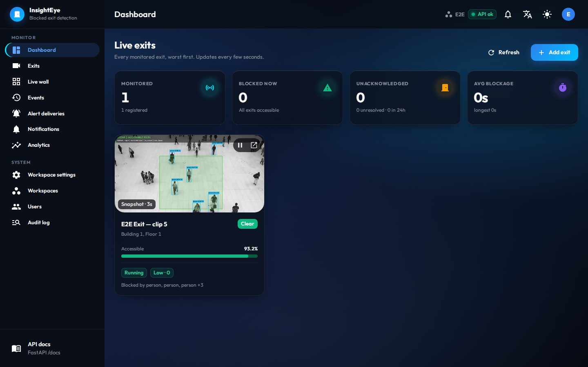
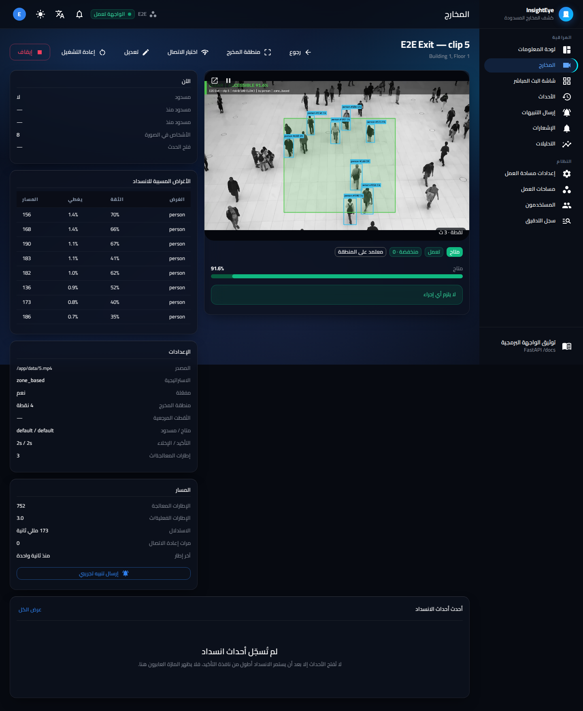

# Screens

The operator console on the shared InsightEye UI (`@insighteye/ui`). Captured by
`frontend/packages/insighteye-ui/scripts/capture.mjs` (APP_KEY=blocked-exit) against a scratch stack.
The e2e suite had registered one exit on `5.mp4` and started its worker, so the dashboard, the camera page
and the live wall show live annotated frames.

| Folder | Look |
|---|---|
| `screenshots/desktop-dark/` | 1440×900, dark (default) |
| `screenshots/desktop-light/` | 1440×900, light |
| `screenshots/desktop-ar/` | 1440×900, dark, Arabic, right to left |
| `screenshots/phone/` | 390×844, dark |

Each folder has the same pages:

| # | Page |
|---|---|
| 00 | Sign in |
| 01 | Dashboard: live exits |
| 02 | Exits |
| 03 | One exit: live view, verdict, objects, configuration, connection test |
| 04 | Exit region editor |
| 05 | Live wall |
| 06 | Blockage events, with CSV export |
| 07 | Alert deliveries (email / webhook) |
| 08 | Notifications |
| 09 | Analytics |
| 10 | Workspace settings |
| 11 | Workspaces (superadmin) |
| 12 | Users (superadmin) |
| 13 | Audit log (superadmin) |

